# DOSW_ParcialT2_DanielBarrera

## Índice
1. [Datos del estudiante](#1-datos-del-estudiante)
2. [Descripción del proyecto](#2-descripción-del-proyecto)
3. [Despliegue](#3-despliegue)
4. [Estructura del proyecto](#4-estructura-del-proyecto)
5. [Tecnologías y dependencias](#5-tecnologías-y-dependencias)
6. [Configuración y variables de entorno](#6-configuración-y-variables-de-entorno)
7. [Cómo ejecutar](#7-cómo-ejecutar)
8. [Pruebas](#8-pruebas)
9. [Docker](#9-docker)
10. [CI/CD](#10-cicd)
11. [Herramientas de modelado y diseño (evidencias)](#11-herramientas-de-modelado-y-diseño-evidencias)

## 1. Datos del estudiante

| Campo | Valor |
|---|---|
| Nombre completo | Daniel Alfred Barrera Araque |
| Grupo | 1 |
| Profesor agregado al repositorio | ☐ |

## 2. Descripción del proyecto

API REST base del Parcial Práctico del Segundo Tercio de DOSW, construida con Spring Boot y MongoDB.
Sigue una arquitectura MVC por capas (controller → core → persistence) y ya incluye seguridad base,
documentación con Swagger, contenedor Docker, pipeline de CI/CD y despliegue en Azure.
Por ahora expone solo un endpoint de salud; la funcionalidad se implementa durante el laboratorio.

## 3. Despliegue

| Recurso | URL |
|---|---|
| Servicio en Azure | https://dosw-parcial-danielbarrera-gsgkbxc6gdhmgxf6.northcentralus-01.azurewebsites.net |
| Health | https://dosw-parcial-danielbarrera-gsgkbxc6gdhmgxf6.northcentralus-01.azurewebsites.net/api/v1/health |
| Swagger | https://dosw-parcial-danielbarrera-gsgkbxc6gdhmgxf6.northcentralus-01.azurewebsites.net/swagger-ui/index.html |

Azure App Service (Linux, contenedor, plan F1) en la región North Central US, con MongoDB Atlas como base de datos.

## 4. Estructura del proyecto

```
DOSW_ParcialT2_DanielBarrera/
├── docs/
│   ├── uml/                      # diagramas fuente
│   └── images/                   # exportes y evidencias del README
├── src/main/java/edu/dosw/parcial/
│   ├── controller/               # capa de presentación (HTTP)
│   │   ├── dtos/request/         # DTOs de entrada
│   │   ├── dtos/response/        # DTOs de salida
│   │   ├── mappers/              # Mapper IN: DTO ↔ dominio
│   │   └── handlers/             # GlobalExceptionHandler
│   ├── core/                     # lógica de negocio
│   │   ├── services/             # interfaces e implementaciones de servicios
│   │   ├── models/               # objetos de dominio
│   │   ├── validators/           # reglas de negocio
│   │   └── utils/                # utilidades compartidas
│   ├── persistence/              # acceso a datos
│   │   ├── entities/             # clases @Document (MongoDB)
│   │   ├── repositories/         # MongoRepository
│   │   └── mappers/              # Mapper OUT: dominio ↔ Document
│   ├── config/                   # SecurityConfig, SwaggerConfig
│   └── main/                     # clase con @SpringBootApplication
├── src/main/resources/application.yaml
├── src/test/java/edu/dosw/parcial/{controller, core, persistence}
├── Dockerfile
├── .dockerignore
├── .github/workflows/ci-cd.yml
└── pom.xml
```

## 5. Tecnologías y dependencias

| Tecnología | Versión | Para qué se usa |
|---|---|---|
| Java | 21 | Lenguaje |
| Spring Boot | 4.1.1 | Framework base (Web MVC, Validation) |
| Spring Data MongoDB | (Spring Boot) | Persistencia en MongoDB |
| Spring Security + JJWT | (Spring Boot) / 0.12.3 | Autenticación y autorización con JWT |
| springdoc-openapi | 3.1.1 | Documentación Swagger UI |
| Lombok | (Spring Boot) | Getters, setters, constructores, `@Slf4j` |
| MapStruct | 1.6.3 | Mappers entre DTOs, dominio y documentos |
| JUnit 5 + Mockito | (Spring Boot) | Pruebas unitarias |
| Jacoco | 0.8.15 | Reporte de cobertura |
| SonarQube (sonar-maven-plugin) | 3.10.0.2594 | Análisis de calidad |
| Docker | — | Contenedor de la aplicación |
| GitHub Actions | — | Pipeline CI/CD |
| Azure App Service | — | Despliegue |

## 6. Configuración y variables de entorno

| Variable | Descripción | Ejemplo |
|---|---|---|
| `MONGODB_URI` | Cadena de conexión a MongoDB | `mongodb://localhost:27017/dosw_parcial` |
| `JWT_SECRET` | Secreto para firmar los JWT (Base64, mínimo 44 caracteres) | `<secreto_base64>` |
| `PORT` | Puerto del servidor (por defecto 8080) | `8080` |

Ninguna credencial se guarda en el repositorio.

## 7. Cómo ejecutar

**Mongo local con Docker**
```bash
docker run -d -p 27017:27017 --name mongo-parcial mongo:7
```

**Local con Maven**
```bash
./mvnw spring-boot:run
```

**Local con Docker**
```bash
docker build -t dosw-parcial:local .
docker run -p 8080:8080 -e JWT_SECRET=<su_secret_base64> dosw-parcial:local
```

Verificación: `http://localhost:8080/api/v1/health` y `http://localhost:8080/swagger-ui/index.html`.

## 8. Pruebas

```bash
./mvnw test
```

Reporte de cobertura: `target/site/jacoco/index.html`.

**Pruebas en verde**

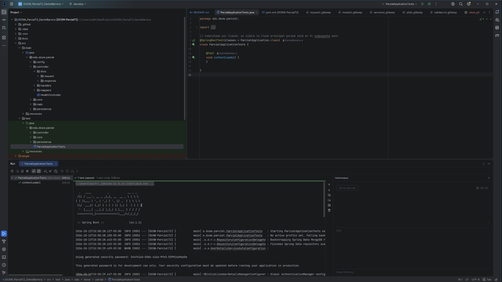
**Reporte de cobertura Jacoco**

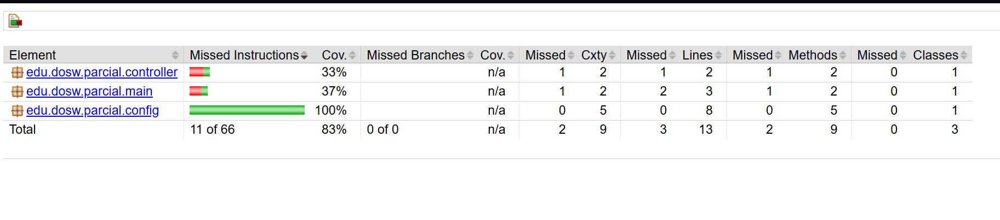

## 9. Docker

```bash
docker build -t dosw-parcial:local .
docker run -p 8080:8080 -e JWT_SECRET=<su_secret_base64> dosw-parcial:local
```

**Contenedor corriendo**

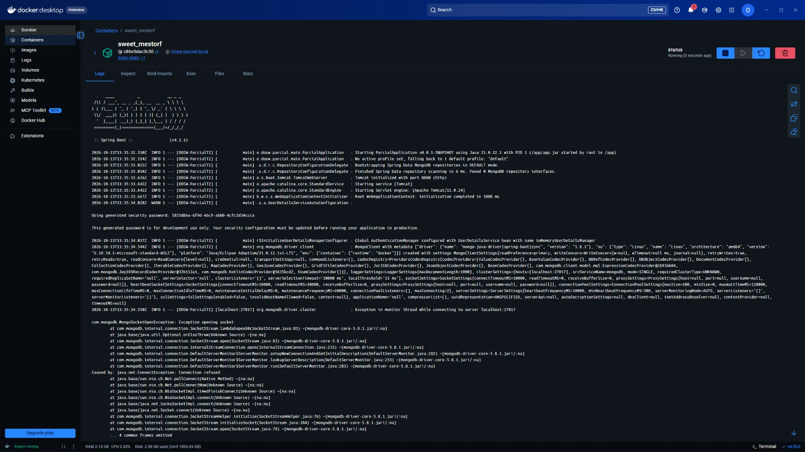

## 10. CI/CD

Pipeline en `.github/workflows/ci-cd.yml`, se ejecuta en cada push a `main` y `develop`:

1. **test**: compila y ejecuta las pruebas (`mvn verify`).
2. **docker**: construye la imagen y la publica en Docker Hub.
3. **deploy**: despliega la imagen en Azure App Service.

Secrets usados: `DOCKERHUB_USERNAME`, `DOCKERHUB_TOKEN`, `AZURE_CREDENTIALS`, `AZURE_WEBAPP_NAME`, `JWT_SECRET`.

**Workflow en verde**

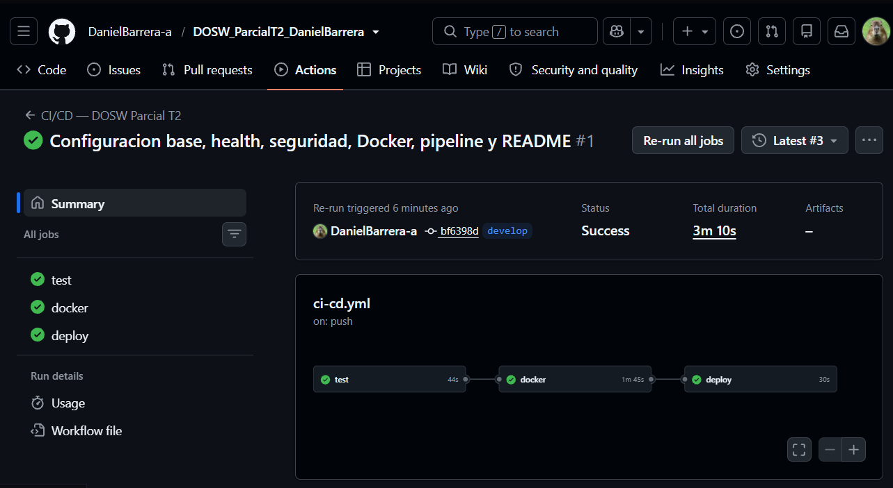

## 11. Herramientas de modelado y diseño (evidencias)

**Herramienta de modelado: Draw.io**

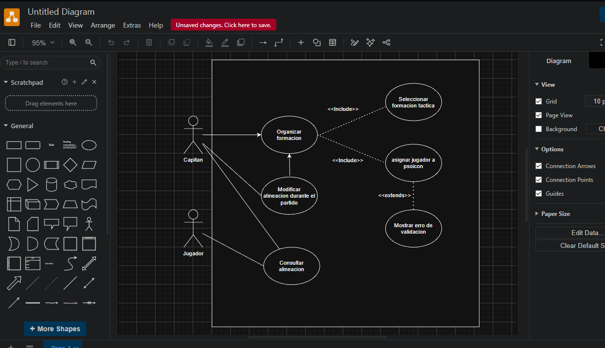
**Herramienta de diseño: Figma**

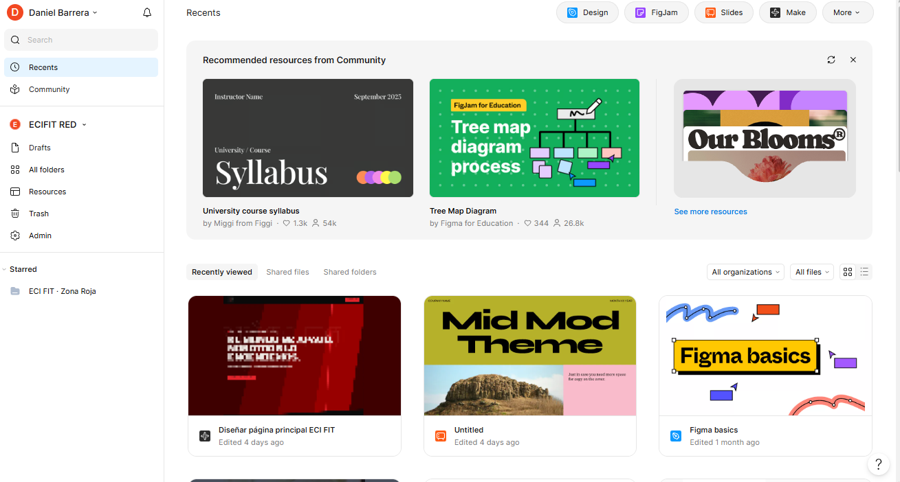


# Solucion del parcial

##Solucion por Paula Diaz y Daniel Barrera

## Se trabajo en el repositorio de Daniel Barrera pero ambos creamos los pre requistos del parcial

### Anexo link Github Paula: https://github.com/paulisdiar/DOSW_ParcialT2_PaulaDiaz.git

## Asignacion del equipo de producto

La tabla con el diseño de los endpoints esta guardada en Excel en la carpeta docs del repositorio: [docs/tabla-api.xlsx](docs/tabla-api.xlsx)


## Preguntas para la revisión con Producto:

¿Cuál es la diferencia entre una validación de entrada y una validación de negocio? Seleccionen tres reglas del caso, incluyendo al menos una de cada tipo, y justifiquen su clasificación.

La validación de entrada se encarga de verificar que los datos que ingresan cumplen con caracteristicas definidas para el campo donde se estan poniendo, como la cantidad de caracteres o el formato con un @ para correo en cambio la validacion de negocio se encarga de revisar que se cumplan las reglas como la paleta de color.

1. Nombre de 3 a 60 caracteres 
    Es una validacion de entrada porque esta verificando que el nombre ingresado cumpla con este formato
2. Subtotal de productos mínimo $3.500
   Es una validacion de entrada porque esta verificando que en el pedido el total del valor cumpla con este minimo
3. De 1 a 5 productos activos
   Es una validacion de negocio porque esta verificando que se cumplan las reglas para poder crear el pedido


En Pedir un turno, ¿cómo debe responder la API si fallan varias condiciones? Expliquen qué error se informa y qué cambios deben evitarse. 
Hacer un pedido
Deberia responder con un codigo indicando el error segun la condicion que no cumple y mostrar el estado Failure de la solicitud


## Asignacion del equipo de Arquitectura

### Diagrama de componentes general

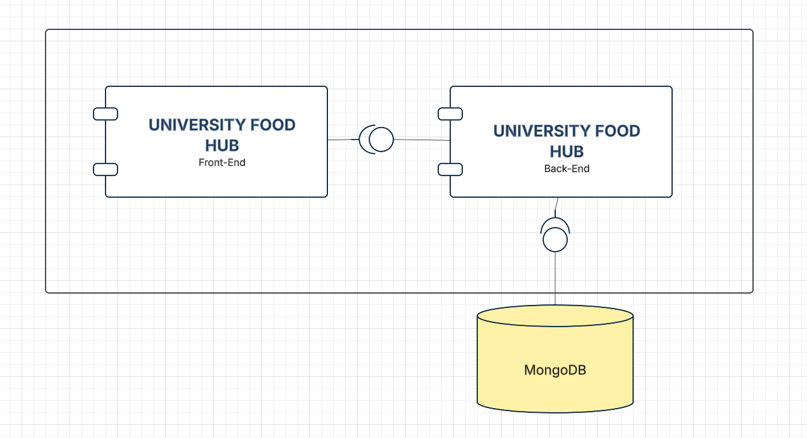

El Front-End se comunica con el Back-End por medio de la API REST y el Back-End es el unico que se conecta con MongoDB para guardar y consultar la informacion.

### Diagrama de componentes especifico (MVC)

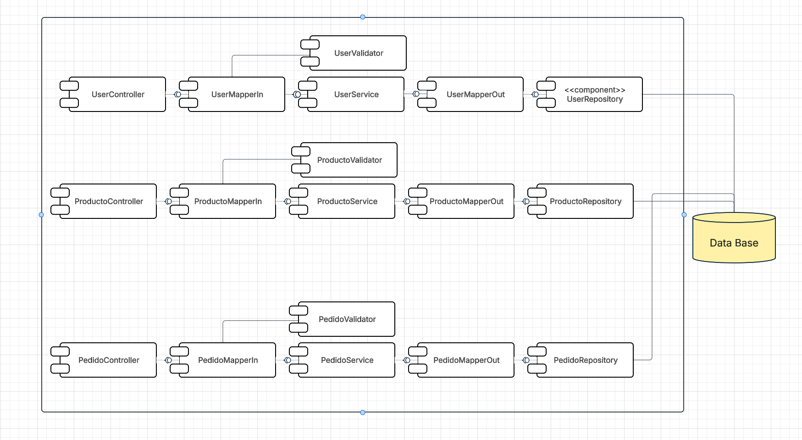

Separamos la aplicacion en tres modulos: usuarios, productos y pedidos. Cada uno sigue el mismo orden de capas: Controller, MapperIn, Service, MapperOut y Repository, y tiene su propio validador para las reglas de negocio.

### Diagrama de clases

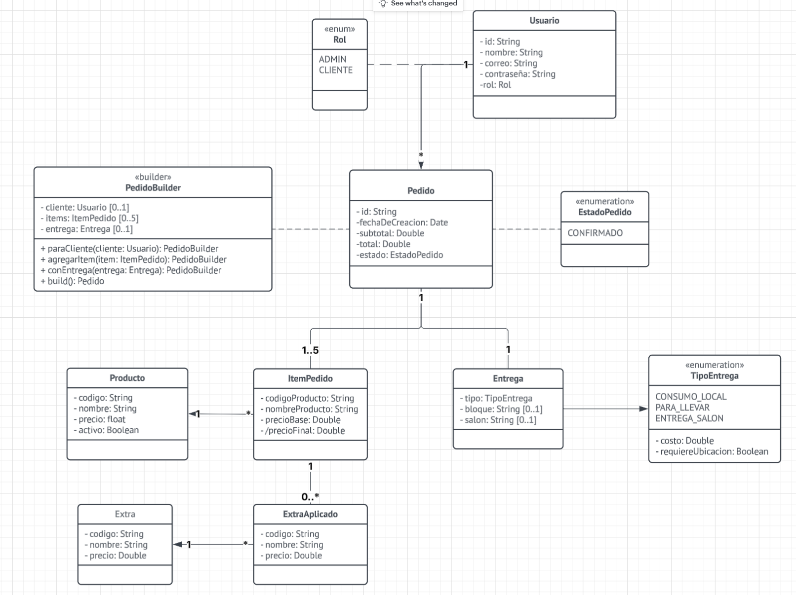

Un usuario puede hacer varios pedidos, y cada pedido tiene de 1 a 5 productos (con sus extras) y una forma de entrega. Usamos el patron Builder porque el pedido se arma por partes (productos, extras y entrega) y solo se crea cuando ya esta completo.

## Preguntas para la revisión con Arquitectura:

### ¿Qué problemas aparecen cuando no se separan correctamente las capas? Presenten un ejemplo del caso y expliquen cómo distribuyen sus responsabilidades.

Cuando no se separan de manera correcta, se violan los principios SOLID porque se mezcla la logica de negocio con las demas capas de vista y controlador. Esto haria dificil modificar y probar el codigo sin dañar lo que hay

### ¿Qué diferencia existe entre un validador, una utilidad y un servicio? Ubiquen un ejemplo de cada uno en su diseño e indiquen su responsabilidad.

Validador: Verifica que se cumplan reglas antes de continuar, evita hacer procesos erroneos
Se podria validar que el pedido se eligio o no para los salones disponibles para entrega 

Utilidad: Son funciones reutilizables que no se relacionan con las reglas de negocio
podria ser la creacion de codigo automatico para los productos

Servicio: Es la coordinación de operaciones y las reglas de negocio para poder cumplir un caso de uso
La creación de un pedido muestra esta coordinación, ya que se agregan los productos y la entrega


### ¿Qué diferencia existe entre el Mapper IN y el Mapper OUT? Indiquen dónde se ubican y qué representaciones transforman cada uno.

El mapperIn se ubica entre el controller y el service y el mapper out esta entre el repositorio y el service

El mapperIn se encarga de traducir los datos externos que entran a nuestra Api en datos que el sistema sabe como manejar y el mapperOut se encarga de traducir nuestros datos de la Api a datos que el repository pueda utilizar


Retomen las tres reglas clasificadas en el paso anterior: ¿en qué componente debe ejecutarse cada una y por qué? 

1. Nombre de 3 a 60 caracteres
   Se valida en la entrada de la API, porque si no cumple con esa cantidad de caracteres no deberia poderse agregar ese producto
2. Subtotal de productos mínimo $3.500
   Se valida en el core porque para crear el pedido debe cumplirse 
3. De 1 a 5 productos activos
   Se valida en el core porque si no cumple no puede hacerse el pedido

### 4.Asignación del Equipo de Seguridad - Proteger el acceso y la información:


Una vez finalizada la asignación, su líder técnico le pide que se reúna con el área de seguridad, el equipo le solicita revisar cómo se controlará el acceso a los endpoints y cómo se protegerá la información durante las operaciones. Para ello le invitan a responder las siguientes preguntas:


####    ¿Cuál es la diferencia entre autenticación, autorización e integridad? Expliquen dónde y cómo aplicarán cada concepto en la API, con ejemplos del caso.

Autenticación sirve para verificar el tipo de usuario y asi poder acceder al sistema con la interfaz y funciones de ese usuario
Autorización es que dependiendo el tipo de usuario tiene acceso a funciones diferentes, para que un usuario normal no tenga todas las funciones como de un administrador 
Integridad seria como en la veracidad de los datos, en que los valores se mantienen bien para el funcionamiento de las operaciones 
#### Seleccionen dos riesgos del OWASP Top 10 que se pueden encontrar en su API. Para cada uno, describan cómo se vería ese escenario aplicable a la barbería, su mitigación y cómo verificarían que el control funciona.
1. Broken Acces Control
Aqui tendriamos el problema si el cliente pudiera crear un producto que es una funcion que solo deberia tener el administrador, para evitar esto se protegen los endpoints con la autorizacion. Para la verficacion cuando el cliente vuelva a ingresar no deberia permitirle  crear ningun producto
2. Injection
3. Si algun cliente utilizara los campos para ingresar datos para acceder a informacion de la base de datos, deberian validarse los datos recibidos y evitar dar informacion de mas al usuario. Se verificaria tratando esos datos y comprobando que no permite hacer consultas ni dar acceso a datos
#### ¿Cuál de los tipos de autenticación es el más adecuado para este MVP? Justifique su respuesta  
Para este MVP consideramos que JWT es el mas adecuado ya que podemos verificar la identidad del usuario cuando inicia sesion y proteger los endpoints con los tokens

## 5. Asignación del Equipo de Calidad - Definir cómo comprobar el comportamiento

### ¿Cómo comprobaría que se respeta el orden y que, ante una falla, no se crea el pedido ni se modifica la información?

Para comprobarlo hariamos pruebas usando TDD para verificar que falla la creacion del pedido, una prueba para el caso exitoso y pruebas para las posibles fallas que puedan ocurrir para ver que no cree un pedido o modifique si falla
### a. Explique cómo las pruebas aportan evidencia del cumplimiento de las reglas de negocio. Distingan qué verificarían con pruebas unitarias.

Las pruebas aportan evidencia mostrando el resultado esperado de una funcionalidad que cumple las reglas de negocio
Con las pruebas unitarias podriamos verificar cosas mas especificas como que el calculo del total del pedido es correcto

### b. Explique brevemente y con justificación si considera que las pruebas por sí solas garantizan la ausencia de errores.

No, podrian reducir la ausencia pero pueden haber errores que no se hayan contemplado durante la creacion de las pruebas o si alguna prueba queda mal podria afectar tambien

## 6. Asignación del Equipo de DevOps - Definir cómo comprobar el comportamiento

### a. ¿Cuáles son las etapas principales de un pipeline CI/CD y qué propósito tiene cada una?

- Build: compila el proyecto para verificar que el codigo no tenga errores
- Test: ejecuta las pruebas para comprobar que todo funciona como se espera
- Analisis de calidad: revisa la cobertura y la calidad del codigo (Jacoco y Sonar)
- Empaquetado: construye la imagen Docker de la aplicacion
- Despliegue: publica la imagen y la despliega en Azure


### b. ¿Qué sucede si una prueba falla? ¿Debe permitirse el despliegue? Justifique.

Debe detenerse la ejecución y corregir el problema. No deberia permitirse el despliegue porque si una prueba falla podrian aparecer errores que dañen el despliegue
### c. ¿Para qué sirven los logs y qué registrarían para investigar un pedido fallido o un error de autenticación?

Sirven para identificar errores y encontrar los problemas de forma mas facil. para un pedido fallido se registraria fecha y hora y el estado del pedido, asi se podria revisar cuando paso y catalogar los fallidos para identificar errores comunes 
### d. Presente ejemplos de información útil para rastrear la operación y de datos que no deben registrarse.

Información útil que sí debe registrarse

- Fecha y hora 
- Identificador del producto
- Endpoint y método HTTP utilizados
- Identificador del pedido
- Tipo de error
- Resultado de la autenticación

Información que no debe registrarse

- Contraseñas
- Tokens 
- Secretos 
- Datos personales 
- Información confidencial

### e. ¿Qué diferencia debe existir entre el detalle del log interno y el mensaje que recibe el cliente?

El log interno debe tener todo el detalle tecnico del error para que el equipo pueda encontrar el problema, como la clase donde fallo o la excepcion. En cambio el cliente solo debe recibir un mensaje claro y sencillo, por ejemplo "El subtotal del pedido no alcanza el minimo de $3.500", sin mostrar detalles internos que puedan ser usados para atacar la aplicacion.


# Implementación y evidencias

## Cómo ejecutar la aplicación y las pruebas

Variables de entorno que necesita la aplicación (los valores no se suben al repositorio):

| Variable | Para qué sirve |
|---|---|
| `MONGODB_URI` | Cadena de conexión a MongoDB (por defecto `mongodb://localhost:27017/dosw_parcial`) |
| `JWT_SECRET` | Secreto en Base64 para firmar los tokens JWT |
| `ADMIN_PASSWORD` | Contraseña del usuario administrador que se crea al iniciar |
| `CLIENTE_PASSWORD` | Contraseña del usuario cliente que se crea al iniciar |
| `ADMIN_CORREO` / `CLIENTE_CORREO` | Opcionales, por defecto `admin@foodhub.edu.co` y `cliente@foodhub.edu.co` |
| `PORT` | Puerto del servidor (por defecto 8080) |

Levantar MongoDB local:
```bash
docker run -d -p 27017:27017 --name mongo-parcial mongo:7
```

Ejecutar la API:
```bash
./mvnw spring-boot:run
```

Ejecutar las pruebas y generar el reporte de cobertura (`target/site/jacoco/index.html`):
```bash
./mvnw verify
```

Al iniciar, la aplicación crea en la base de datos los usuarios predefinidos (ADMIN y CLIENTE) y carga el catálogo inicial (PROD-001 a PROD-005 y EXT-001 a EXT-005). Para probar en Swagger se inicia sesión, se copia el token y se pega en el botón **Authorize**.

## Pruebas funcionales en Swagger

Las pruebas se hicieron con la API corriendo en local contra MongoDB. Debajo de cada captura están los logs que dejó la aplicación en esa petición.

### Swagger y endpoints

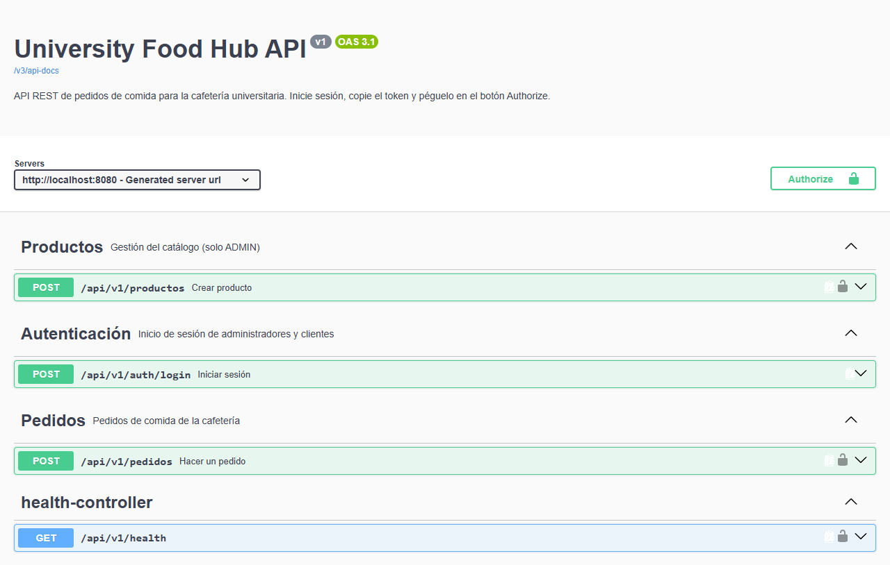

```
INFO  DataInitializer       : Usuario ADMIN creado en la base de datos
INFO  DataInitializer       : Usuario CLIENTE creado en la base de datos
INFO  CatalogoInitializer   : Producto base PROD-001 cargado en el catálogo
INFO  CatalogoInitializer   : Extra EXT-001 cargado en el catálogo
```

### Iniciar sesión

Inicio de sesión correcto, devuelve el token (200):

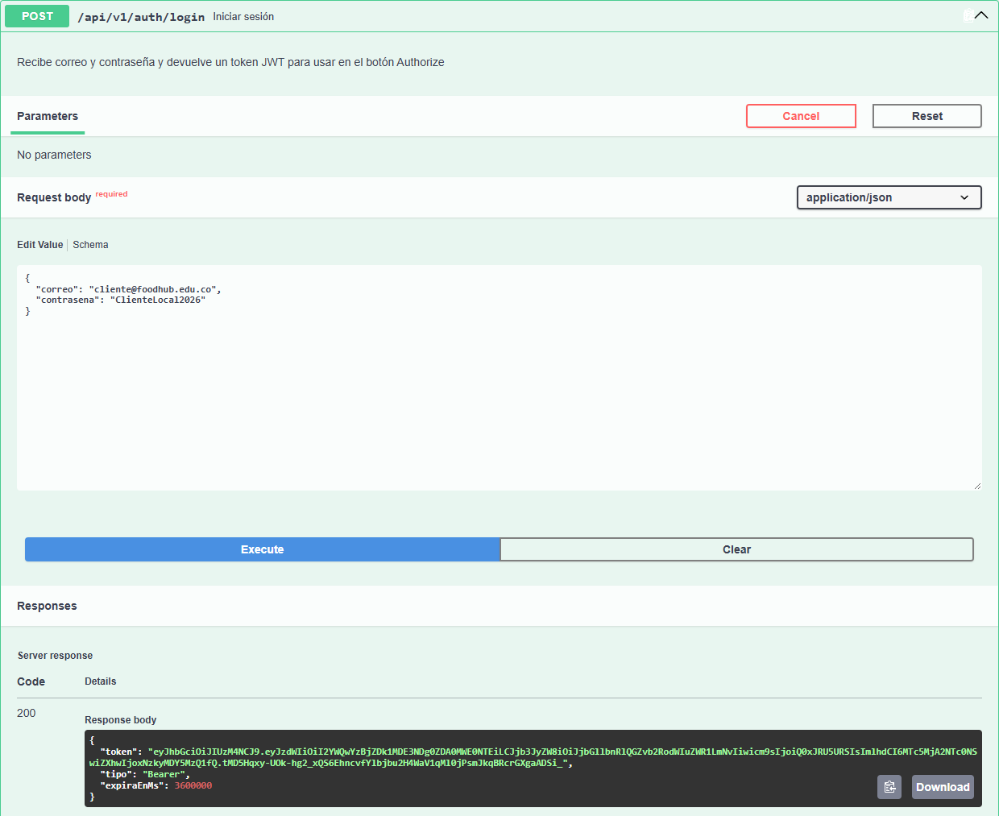

```
INFO  AuthService : Inicio de sesión exitoso: usuario 6ad0c0cd95017484d041a451 con rol CLIENTE
```

Contraseña incorrecta (401):


```
WARN  AuthService : Inicio de sesión rechazado: contraseña incorrecta para el usuario 6ad0c0cd95017484d041a451
```

Token pegado en el botón Authorize:

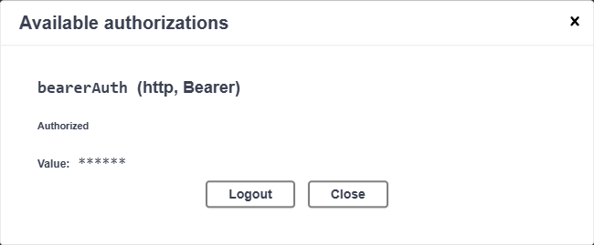

### Crear productos

Producto creado por el ADMIN, el código lo genera el servidor (201):

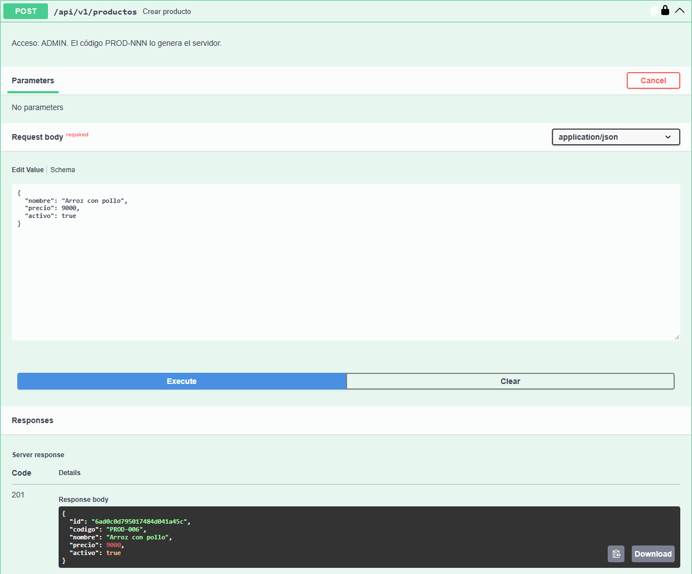

```
INFO  ProductoService : Producto creado: PROD-006 (Arroz con pollo)
```

E01 - nombre muy corto y precio en 0, se indican los campos inválidos (400):

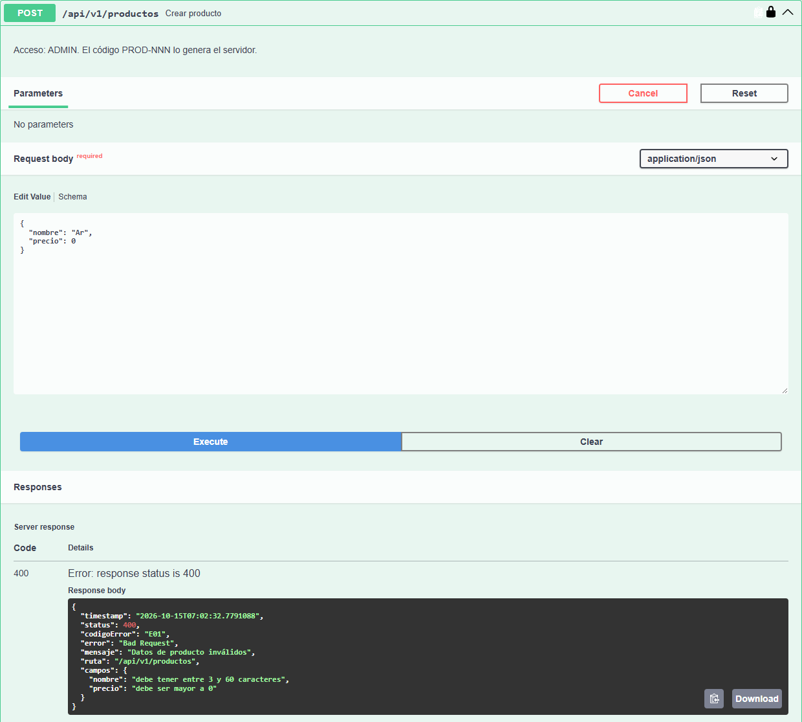

```
WARN  GlobalExceptionHandler : Petición rechazada por datos inválidos [E01] en /api/v1/productos: [nombre, precio]
```

Producto con un nombre que ya existe (409):

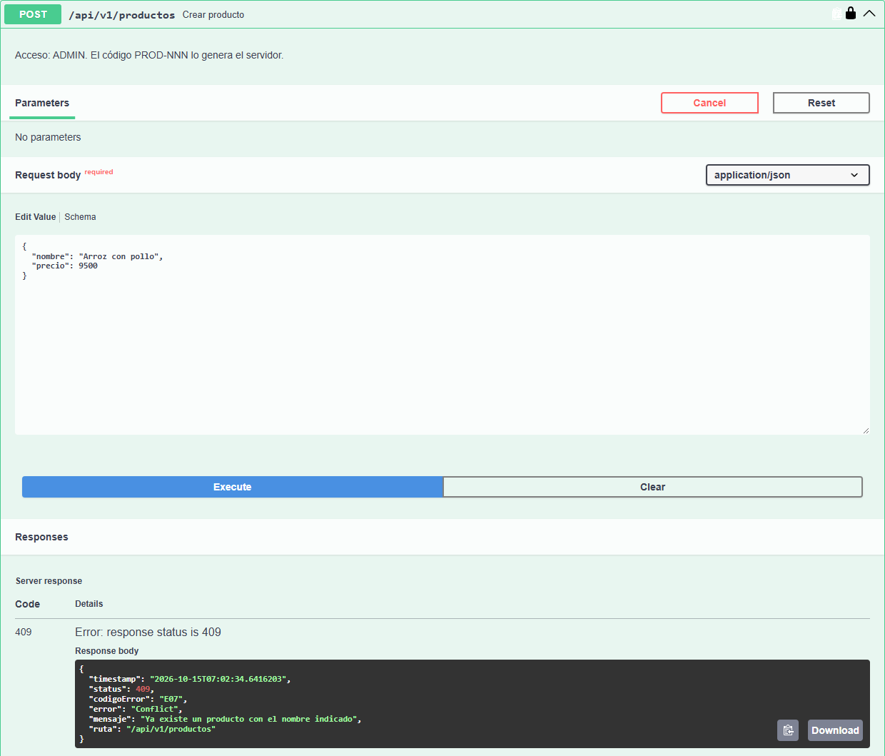

```
WARN  ProductoService        : Producto duplicado: ya existe 'Arroz con pollo'
WARN  GlobalExceptionHandler : Conflicto [E07] en /api/v1/productos: Ya existe un producto con el nombre indicado
```

Un CLIENTE intenta crear un producto (403):


```
WARN  SecurityConfig : Acceso denegado por rol a /api/v1/productos
```

Sin token (401):


```
WARN  SecurityConfig : Acceso sin token válido a /api/v1/productos
```

### Hacer un pedido

E14 - pedido válido con entrega en salón, el servidor calcula el desglose y el pedido queda CONFIRMADO (201). Subtotal: 5.000 + 800 + 1.500 + 3.500 = 10.800, total con la entrega de 1.000 = 11.800:

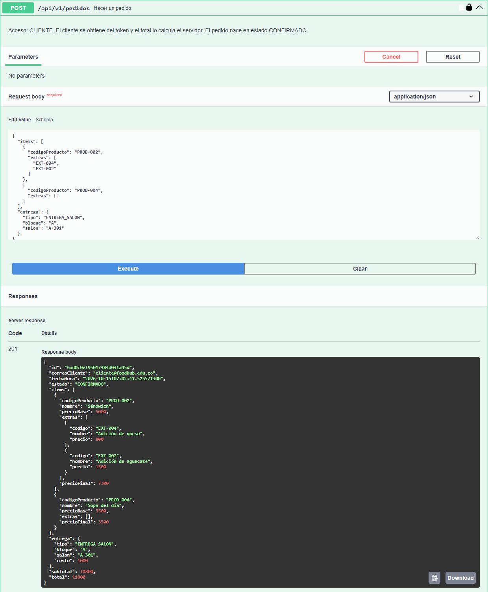

```
INFO  PedidoService : Pedido 6ad0c0e195017484d041a45d creado para el cliente 6ad0c0cd95017484d041a451: subtotal 10800.0, total 11800.0
```

E4 - solo PROD-005, el subtotal de $2.500 no alcanza el mínimo (422):


```
WARN  PedidoService          : Pedido rechazado (E4): subtotal 2500.0 bajo el mínimo
WARN  GlobalExceptionHandler : Regla de negocio incumplida [E4] en /api/v1/pedidos: El subtotal de $2.500 está por debajo del mínimo de $3.500
```

E5 - entrega en el bloque C (422):

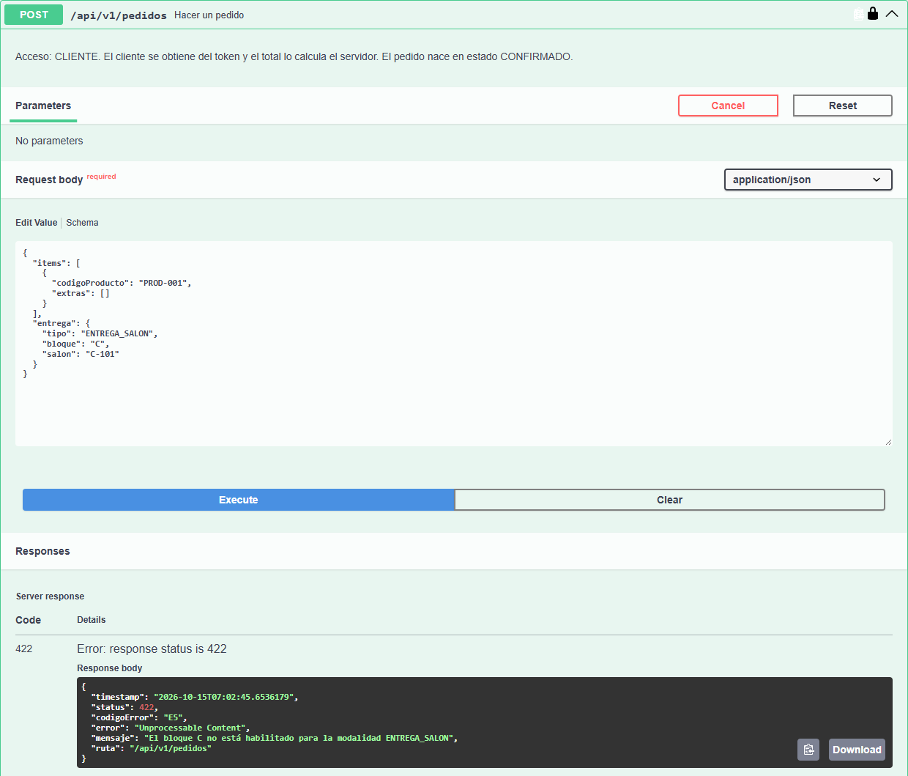

```
WARN  PedidoService          : Pedido rechazado (E5): bloque C no habilitado
WARN  GlobalExceptionHandler : Regla de negocio incumplida [E5] en /api/v1/pedidos: El bloque C no está habilitado para la modalidad ENTREGA_SALON
```

E06 - pedido con 6 productos (400):

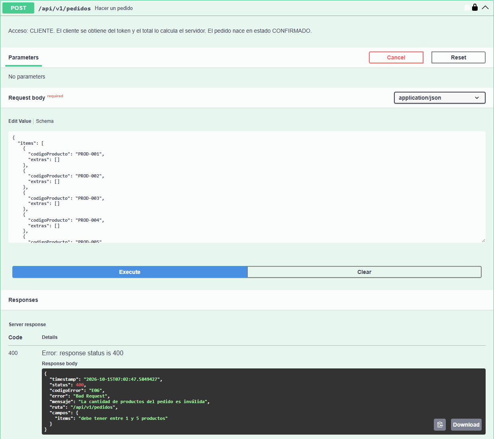

```
WARN  GlobalExceptionHandler : Petición rechazada por datos inválidos [E06] en /api/v1/pedidos: [items]
```

E02 - producto que no existe (404):


```
WARN  PedidoService          : Pedido rechazado (E02): el producto PROD-099 no existe
WARN  GlobalExceptionHandler : Recurso no encontrado [E02] en /api/v1/pedidos: El producto PROD-099 no existe
```

E03 - extra que no existe (404):


```
WARN  PedidoService          : Pedido rechazado (E03): extras inexistentes [EXT-099]
WARN  GlobalExceptionHandler : Recurso no encontrado [E03] en /api/v1/pedidos: Uno o más extras seleccionados no existen: EXT-099
```

Un ADMIN intenta hacer un pedido (403):

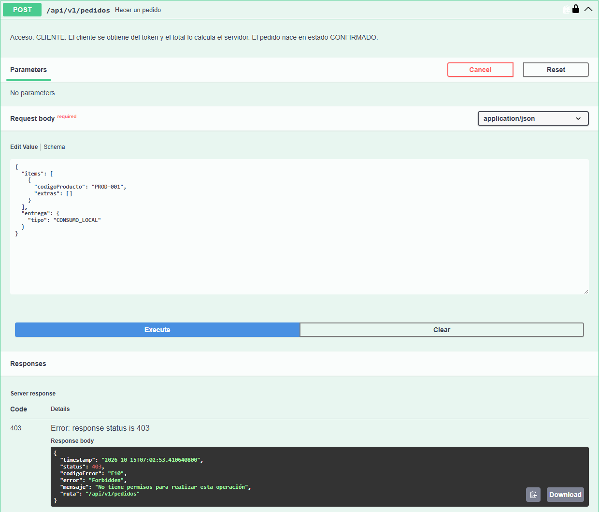

```
WARN  SecurityConfig : Acceso denegado por rol a /api/v1/pedidos
```

## Enlaces

| Recurso | URL |
|---|---|
| Aplicación en Azure | https://dosw-parcial-danielbarrera-gsgkbxc6gdhmgxf6.northcentralus-01.azurewebsites.net |
| Swagger en Azure | https://dosw-parcial-danielbarrera-gsgkbxc6gdhmgxf6.northcentralus-01.azurewebsites.net/swagger-ui/index.html |
